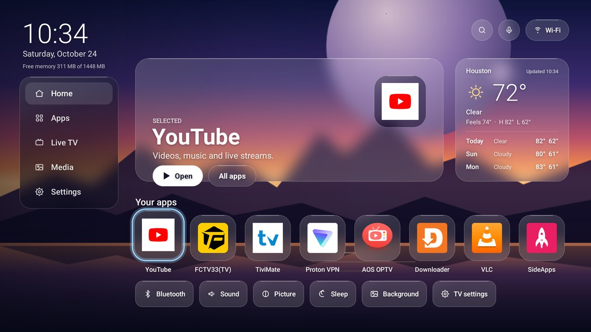

# WLH Glass

**Downloader code: 3985133**

A fast, ad-free "liquid glass" home screen for Google TV and Android TV boxes. No root. Nothing on your TV gets turned off.



Built and tested on an **onn. Full HD Streaming Device** (Google TV, Android 14). It should work on other Google TV / Android TV boxes running Android 9 or newer.

## What you get

- **Your apps, no ads.** A glass row of up to 8 favorite apps with their real icons, plus an All apps screen. Pick and order them with the remote in Settings › Favorites. No sponsored rows, no trailers.
- **Recently opened.** The last 6 apps you opened, one press away (Google TV keeps "Continue watching" to itself, so WLH Glass tracks app launches instead).
- **Hide apps.** Settings › Hide apps removes clutter from All apps. Nothing is disabled or uninstalled.
- **World clocks.** Up to 3 extra cities next to the main clock (Settings › World clocks).
- **Clock in your location's time.** The clock follows the time zone of your weather location (Settings › Clock time zone switches back to the TV's own time). 24-hour by default; change it in Settings › Clock format (24-hour, 12-hour, or follow the TV).
- **Live weather, anywhere.** Type any city or country in Settings › Weather location (a country uses its capital). Current temperature, feels-like, high/low and a 3-day forecast (Open-Meteo, no account needed). US locations also show National Weather Service alerts.
- **Your own backgrounds, sent from your phone.** Settings › Add photos from phone shows a QR code. Scan it on the same Wi-Fi, pick photos, done. Flip with one button or rotate every 15 minutes.
- **VPN and location pill.** Shows whether a VPN is on, plus the city, country and provider your connection appears from. Updates as soon as the VPN connects or drops. OK opens ProtonVPN if it's installed.
- **HDMI inputs.** On Google TV sets with HDMI ports, an Inputs button switches sources. Hidden on streaming sticks.
- **Accent color.** Blue, gold, green, pink, purple or white focus glow.
- **Home button takeover.** An optional switch makes the remote's Home button and power-on open WLH Glass. Turn it off any time to get Google TV back.
- **Sleep timer.** 15 to 120 minutes, keeps counting while you watch other apps.
- **Screensaver.** Cycles through all your background photos (2 minutes each) with a big clock and the weather.
- **Auto-update.** Settings › App update finds and installs new versions (you confirm on screen).
- **Light.** About 35–45 MB of memory. Low power mode turns the blur off.

## Compatibility

| Device | Status |
|---|---|
| onn. Full HD Streaming Device (Google TV, Android 14) | Tested, works |
| Other Google TV devices (Chromecast with Google TV, onn 4K, TCL/Hisense/Sony Google TV sets) | Should work (Android 9+) |
| Android TV boxes (Nvidia Shield, Xiaomi Mi Box, generic Android TV) | Should work. Some let you pick WLH Glass as the default home directly |
| Fire TV, Roku, Samsung Tizen, LG webOS, Apple TV | Not supported (not Android TV) |

Requires Android 9 or newer for the sleep timer. The home screen itself runs on Android 6+.

Tried it on another device? Open an issue with the model, Android version and what worked.

## Install (no PC needed)

1. On the TV, install **Downloader** (by AFTVnews) from the Play Store.
2. In Downloader, type the code **3985133** and press Go. It always downloads the newest version.
   (Long link, if you need it: `https://raw.githubusercontent.com/whitecoco20/wlh-glass-updates/main/releases/wlh-glass-latest.apk`, or `aftv.news/3985133` in any browser.)
   Allow Downloader to install apps when Android asks. If Play Protect warns you, choose **Install anyway**.
3. Open **WLH Glass** from your apps.

### "Install blocked" or "Play Protect is protecting you"

WLH Glass isn't on the Play Store, so Android warns you the first time. Two separate switches can block it:

1. **Downloader isn't allowed to install apps.** TV Settings › Apps › Security & restrictions › Unknown sources (on some TVs: Settings › Privacy › Security & restrictions) › turn **Downloader** on.
2. **Play Protect blocks it.** On the warning, choose **More details › Install anyway**. If there's no "Install anyway":
   Play Store › your profile icon › Play Protect › gear icon › turn off **Scan apps with Play Protect**, install WLH Glass, then turn it back on.
   WLH Glass keeps working after you turn Play Protect back on.

Some TVs show a second warning when you turn on the Home button switch (accessibility). That's the same rule; choose **Allow** or follow the "restricted setting" step below.

### Install from a Windows PC instead

See [`windows/install.bat`](windows/install.bat). You need Google's platform-tools (adb), USB debugging turned on in the TV's Developer options, and your TV's IP address.

## Make Home open WLH Glass

On Google TV, Android ignores the normal "default home app" setting, and the only way to replace Google TV's home is to disable it, which has left some Google TV devices stuck restarting. WLH Glass does **not** do that. It uses a small accessibility service that only reacts to the Home key.

1. In WLH Glass go to **Settings › Home button** and press OK. Android opens the Accessibility screen.
2. Select **WLH Glass Home button** and turn it **On**.
   If it's greyed out ("restricted setting"): Settings › Apps › WLH Glass › ⋮ › **Allow restricted settings**, then try again.
3. Press Home. You land on WLH Glass. It also opens a few seconds after the TV starts.

To go back to Google TV: **WLH Glass › Settings › Home button › OK**.

**Don't "Force stop" WLH Glass.** Android turns accessibility switches off when an app is force-stopped.

## Backgrounds

Put `.jpg`, `.png` or `.webp` files (landscape, 1920×1080 is ideal) in:

```
/sdcard/Android/data/com.wlh.glass/files/backgrounds/
```

Easiest: **Settings › Add photos from phone** and scan the QR code. The phone page shrinks photos to TV size before sending, and lists or removes photos already on the TV. The receiver only runs while that screen is open and needs the code shown on the TV.

Or use a file manager on the TV, `windows/add-backgrounds.bat`, or:

```
adb push myphoto.jpg /sdcard/Android/data/com.wlh.glass/files/backgrounds/
```

Then press **Background** on the home screen, or pick one (or **Rotate**) in Settings.

## Screensaver

Android TV hides third-party screensavers on many Google TV boxes. To pick WLH Glass from a PC:

```
adb shell settings put secure screensaver_components com.wlh.glass/.GlassDream
```

Back to Google's: `adb shell settings put secure screensaver_components com.google.android.apps.tv.dreamx/.service.Backdrop`

## Known limits

- Google TV's own home keeps running in the background as a safety net. You may see it for a moment at power-on or when pressing Home.
- While the Home switch is on, **Amazon Silk** switches to accessibility mode and its free cursor stops working. Switch to Google TV before using Silk (then reopen Silk), or use TV Bro / Downloader's browser.
- If the pill shows your home city and provider while your VPN app says it's connected, the VPN app is leaving WLH Glass out (split tunneling). Turn split tunneling off, or add WLH Glass to it.
- "Continue watching" isn't possible: Google TV only shares that list with its own home screen.
- The Home switch can only be turned **on** from the TV's Accessibility settings (Android security rule).

## Customize

- **Favorites:** pick them on the TV in Settings › Favorites. The out-of-the-box list is `FAV_PKGS` (and `FAV_BLURB`) in `app/src/com/wlh/glass/GlassView.java`; if fewer than 8 of those are installed, the row fills from your other apps.
- **Weather location:** set on the TV in Settings › Weather location. Lookup uses Open-Meteo geocoding and, for countries, [REST Countries](https://restcountries.com) for the capital.
- **Update feed for your fork:** change `FEED` in `Updater.java` to your repo's `version.json`.

## Build it yourself

No Gradle or Android Studio. On Ubuntu, Debian or Windows WSL:

```
sudo apt install aapt apksigner zipalign android-sdk-platform-23 dalvik-exchange default-jdk
./build.sh
```

The first run creates your own signing key (`glass.keystore`). Keep it safe and never commit it: updates only install over a copy signed with the same key. Your build is a separate app from the releases here unless you change the package name.

## Publishing an update (maintainers)

1. Bump `versionCode`/`versionName` in `app/AndroidManifest.xml`, run `./build.sh`.
2. Copy `build/wlh-glass.apk` to `releases/wlh-glass-X.Y.apk` **and** over `releases/wlh-glass-latest.apk` (the Downloader short code points at that file, so it never changes).
3. Update `version.json` (`versionCode`, `versionName`, `apk` link, `notes`) and push.
   TVs check every 6 hours, or right away from Settings › App update.

## Uninstall

Settings › Apps › WLH Glass › Uninstall, or `windows/uninstall.bat`. Nothing else on the TV was changed, so Google TV's home simply comes back.

## License

MIT, © 2026 Wilhoite Lux Horizon LLC. Weather data by [Open-Meteo](https://open-meteo.com) and the [National Weather Service](https://www.weather.gov).
