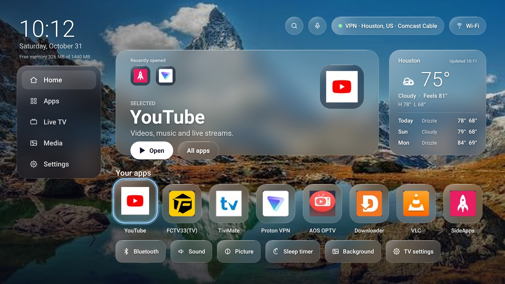
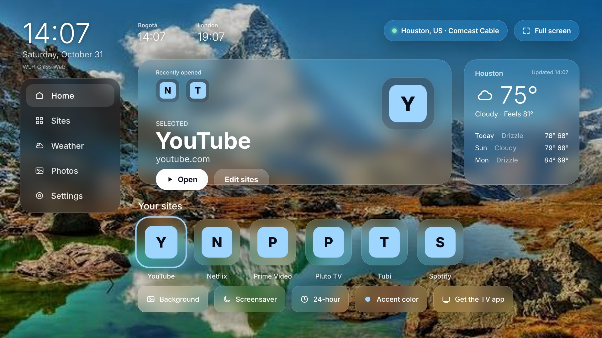

# WLH Glass

**Downloader code: 3985133** (Google TV, Android TV, Fire TV)  ·  **No Android TV? Use [WLH Glass Web](https://raw.githack.com/whitecoco20/wlh-glass-updates/main/docs/index.html)** in any TV or computer browser.

A fast, ad-free "liquid glass" home screen for Google TV, Android TV and Amazon Fire TV. No root. Nothing on your TV gets turned off.



Built and tested on an **onn. Full HD Streaming Device** (Google TV, Android 14). It should work on other Google TV / Android TV boxes running Android 9 or newer.

## What you get

- **13 languages.** English, Español, Português, Français, Deutsch, Italiano, Nederlands, Polski, Türkçe, Русский, 中文, 日本語 and हिन्दी. You pick on first start (it suggests your TV's language); change it any time in Settings › Language. Dates, weather, sports and the phone photo page follow it.
- **Your apps, no ads.** A glass row of up to 8 favorite apps with their real icons, plus an All apps screen. Pick and order them with the remote in Settings › Favorites. No sponsored rows, no trailers.
- **Recently opened.** The last 6 apps you opened, one press away (Google TV keeps "Continue watching" to itself, so WLH Glass tracks app launches instead).
- **Profiles.** Everyone in the house gets their own favorites, hidden apps, recently opened, background, accent color and world clocks. Switch from **Profile** in the side menu.
- **PIN lock.** Settings › PIN lock: lock chosen apps, and optionally Settings and profile switching, behind a 4-digit PIN. (A determined kid can still reach the TV's own settings through the system; this keeps casual hands out.)
- **Sports scores.** Settings › Sports teams: up to 5 teams. Pick a group (US sports, Soccer International, Europe, Americas, Asia/Africa/Oceania), then a league, then your team. 110+ competitions: NFL, NBA, MLB, NHL, WNBA, college sports; the World Cup, Champions League, Europa League, Nations League, Libertadores; 53 European competitions from the Premier League and La Liga to Poland, Croatia, Serbia, Ukraine and Israel (second tiers, cups and women's leagues included); every South American league; MLS, Liga MX, Central America; Japan, Korea, Saudi Arabia, Australia and African leagues.
- **Scoreboard.** From the side menu press Down onto the Scores card, then OK: every team's standing, record, last result, live score and next 3 games.
- **Screen time.** Settings › Screen time (needs a PIN): a daily limit per profile (30 minutes to 4 hours). The home screen shows the time left. When it runs out, apps return to WLH Glass with a Time's up screen; the PIN adds 30 minutes. Uses the Home button switch to see which app is open.
- **Where to watch.** The scoreboard shows the channel or app carrying each game (ESPN, Peacock, Prime Video, Paramount+, Max, Apple TV...). Select a team and press OK to open that app, or YouTube TV / Fubo / Sling as a fallback.
- **Bedtime.** Settings › Bedtime (needs a PIN): a start time per profile, 7:30 PM to 11 PM. Apps lock until 6 AM; the PIN adds 30 minutes.
- **Hourly forecast.** Move right from All apps onto the weather card and press OK: the next 12 hours with temperature and chance of rain.
- **Share and feedback.** Settings › Share WLH Glass shows a QR code with the install steps. Settings › Send feedback shows a QR code that opens an email on your phone with your TV model and app version filled in.
- **Calendar.** Settings › Calendar shows a QR code. Paste your private iCal link (Google Calendar, iCloud, Outlook) on your phone and the next event shows on the home screen. Repeating events work.
- **News headlines.** Settings › News headlines: global top stories, business, technology, sports, entertainment, science or health, from Google News in your language. Each headline starts with the outlet (Reuters, AP, BBC...) and scrolls across the main card like a ticker so you can read it in full. Off by default.
- **Clock styles.** Standard, Large, Minimal or Analog.
- **Hide apps.** Settings › Hide apps removes clutter from All apps. Nothing is disabled or uninstalled.
- **World clocks.** Up to 3 extra cities next to the main clock (Settings › World clocks).
- **Clock in your location's time.** The clock follows the time zone of your weather location (Settings › Clock time zone switches back to the TV's own time). 24-hour by default; change it in Settings › Clock format (24-hour, 12-hour, or follow the TV).
- **Live weather, anywhere.** Type any city or country in Settings › Weather location (a country uses its capital). Current temperature, feels-like, high/low and a 3-day forecast (Open-Meteo, no account needed). US locations also show National Weather Service alerts.
- **Your own backgrounds, sent from your phone.** Settings › Add photos from phone shows a QR code. Scan it on the same Wi-Fi, pick photos, done. Flip with one button or rotate every 15 minutes.
- **VPN and location pill.** Shows whether a VPN is on, plus the city, country and provider your connection appears from. Updates as soon as the VPN connects or drops. OK opens ProtonVPN if it's installed.
- **HDMI inputs.** On Google TV sets with HDMI ports, an Inputs button switches sources. Hidden on streaming sticks.
- **Accent color.** Blue, gold, green, pink, purple or white focus glow.
- **Home button takeover.** An optional switch makes the remote's Home button and power-on open WLH Glass. Turn it off any time to get Google TV back.
- **Sleep timer.** 15 to 120 minutes, keeps counting while you watch other apps.
- **Screensaver.** Cycles through all your background photos (2 minutes each) with a big clock and the weather.
- **Auto-update.** Settings › App update finds and installs new versions (you confirm on screen).
- **Light.** About 35–45 MB of memory. Low power mode turns the blur off.

## Compatibility

| Device | Status |
|---|---|
| onn. Full HD Streaming Device (Google TV, Android 14) | Tested, works |
| Other Google TV devices (Chromecast with Google TV, onn 4K, TCL/Hisense/Sony Google TV sets) | Should work (Android 9+) |
| Android TV boxes (Nvidia Shield, Xiaomi Mi Box, generic Android TV) | Should work. Some let you pick WLH Glass as the default home directly |
| Amazon Fire TV Stick (Fire OS 6 or newer, 2017+ devices) | **Tested, installs and works.** Runs as an app. Install with Downloader code 3985133. Amazon may block the Home button switch on newer Fire TVs, so open WLH Glass from Your Apps (pin it to the front row) |
| Samsung (Tizen), LG (webOS), Roku, any computer | Use **WLH Glass Web** in the TV's browser (below) |
| Apple TV | Not supported |

Requires Android 9 or newer for the sleep timer. The home screen itself runs on Android 6+.

Tried it on another device? Open an issue with the model, Android version and what worked.

## Price

WLH Glass is a **$100 one-time purchase per TV**. No ads, no account, no subscription.

When you open WLH Glass on a TV that isn't unlocked, it shows a QR code. Scan it with your phone and pay once with Stripe (card, Apple Pay or Google Pay). The TV unlocks by itself a few seconds later, with everything: home screen, weather, news ticker, sports scores, scoreboard, where to watch, world clocks, backgrounds, 13 languages, profiles, PIN lock, screen time and bedtime. The key only works on the TV that showed the code, and it comes back by itself if you reinstall.

After unlocking, the TV shows a second QR code with your **Downloader codes** and step-by-step install help for Fire TV and Google TV. That page opens one time only, so save the codes.

After paying you also get a **license code** (WLH-XXXX-XXXX). If you reset or replace your TV, choose **Restore purchase** on the WLH Glass screen, scan the code and enter your license code and checkout email. A license can move to a new TV 2 times a year. See the [terms of sale](https://raw.githack.com/whitecoco20/wlh-glass-updates/main/docs/terms.html).

## WLH Glass Web (any browser)

WLH Glass Web is also a $100 one-time unlock, per browser. The page shows a QR code and a Buy now button; it unlocks by itself after payment.

**https://raw.githack.com/whitecoco20/wlh-glass-updates/main/docs/index.html**

Open it in the web browser on a Samsung, LG or Roku TV, on a computer, or on a tablet. It uses the same home screen layout as the TV app (side menu, selected card, weather card, a row of 8 tiles, quick buttons), with your favorite websites in place of apps. You get the glass look, the clock (24-hour or 12-hour, following your weather location's time zone), weather for any city or country with US alerts, world clocks, tiles for your favorite sites, background scenes or your own photos (computers and phones), accent colors, a screensaver, sports scores for up to 5 teams with a full scoreboard, profiles (each with its own sites, colors and teams), and 13 languages picked on first start. Arrow keys and the remote's Back button work. Settings stay in that browser. A web page can't open TV apps, so the tiles open websites. Press **Full screen** for the best look.



**Take your TV setup with you.** On the TV: WLH Glass › Settings › **Use on the web**. Scan the QR code with your phone and WLH Glass Web opens with your weather location, world clocks, clock format, accent color and every favorite app that has a website (YouTube, Netflix, Prime Video, Disney+, Hulu, Max, Peacock, Paramount+, Spotify, Plex, Twitch and more). Apps with no website (TiviMate, VLC, sideloaded apps) stay on the TV. Then use **Settings › Send to another device** (or Share/Copy link on the phone) to open it on a work computer. Nothing is uploaded anywhere: the setup travels inside the link. Change something on the TV? Scan again.

The page is `docs/index.html` in this repo: one file, no build step.

## Install (no PC needed)

1. On the TV, install **Downloader** (by AFTVnews) from the Play Store.
2. In Downloader, type the code **3985133** and press Go. It always downloads the newest version.
   (Long link, if you need it: `https://raw.githubusercontent.com/whitecoco20/wlh-glass-updates/main/releases/wlh-glass-latest.apk`, or `aftv.news/3985133` in any browser.)
   Allow Downloader to install apps when Android asks. If Play Protect warns you, choose **Install anyway**.
3. Open **WLH Glass** from your apps.

### "Install blocked" or "Play Protect is protecting you"

WLH Glass isn't on the Play Store, so Android warns you the first time. Two separate switches can block it:

1. **Downloader isn't allowed to install apps.** TV Settings › Apps › Security & restrictions › Unknown sources (on some TVs: Settings › Privacy › Security & restrictions) › turn **Downloader** on.
2. **Play Protect blocks it.** On the warning, choose **More details › Install anyway**. If there's no "Install anyway":
   Play Store › your profile icon › Play Protect › gear icon › turn off **Scan apps with Play Protect**, install WLH Glass, then turn it back on.
   WLH Glass keeps working after you turn Play Protect back on.

Some TVs show a second warning when you turn on the Home button switch (accessibility). That's the same rule; choose **Allow** or follow the "restricted setting" step below.

### Install from a Windows PC instead

See [`windows/install.bat`](windows/install.bat). You need Google's platform-tools (adb), USB debugging turned on in the TV's Developer options, and your TV's IP address.

## Make Home open WLH Glass

On Google TV, Android ignores the normal "default home app" setting, and the only way to replace Google TV's home is to disable it, which has left some Google TV devices stuck restarting. WLH Glass does **not** do that. It uses a small accessibility service that only reacts to the Home key.

1. In WLH Glass go to **Settings › Home button** and press OK. Android opens the Accessibility screen.
2. Select **WLH Glass Home button** and turn it **On**.
   If it's greyed out ("restricted setting"): Settings › Apps › WLH Glass › ⋮ › **Allow restricted settings**, then try again.
3. Press Home. You land on WLH Glass. It also opens a few seconds after the TV starts.

To go back to Google TV: **WLH Glass › Settings › Home button › OK**.

**Don't "Force stop" WLH Glass.** Android turns accessibility switches off when an app is force-stopped.

## Backgrounds

Put `.jpg`, `.png` or `.webp` files (landscape, 1920×1080 is ideal) in:

```
/sdcard/Android/data/com.wlh.glass/files/backgrounds/
```

Easiest: **Settings › Add photos from phone** and scan the QR code. The phone page shrinks photos to TV size before sending, and lists or removes photos already on the TV. The receiver only runs while that screen is open and needs the code shown on the TV.

Or use a file manager on the TV, `windows/add-backgrounds.bat`, or:

```
adb push myphoto.jpg /sdcard/Android/data/com.wlh.glass/files/backgrounds/
```

Then press **Background** on the home screen, or pick one (or **Rotate**) in Settings.

## Screensaver

Android TV hides third-party screensavers on many Google TV boxes. To pick WLH Glass from a PC:

```
adb shell settings put secure screensaver_components com.wlh.glass/.GlassDream
```

Back to Google's: `adb shell settings put secure screensaver_components com.google.android.apps.tv.dreamx/.service.Backdrop`

## Known limits

- Google TV's own home keeps running in the background as a safety net. You may see it for a moment at power-on or when pressing Home.
- While the Home switch is on, **Amazon Silk** switches to accessibility mode and its free cursor stops working. Switch to Google TV before using Silk (then reopen Silk), or use TV Bro / Downloader's browser.
- If the pill shows your home city and provider while your VPN app says it's connected, the VPN app is leaving WLH Glass out (split tunneling). Turn split tunneling off, or add WLH Glass to it.
- "Continue watching" isn't possible: Google TV only shares that list with its own home screen.
- The Home switch can only be turned **on** from the TV's Accessibility settings (Android security rule).


## Download counts

**Installs:** from version 2.7, every install downloads a tiny file once from the **Install counter** release (`stats`), so its download count is the number of installs, whether people used Downloader code 3985133, the README link or an update. Nothing personal is sent; it's an ordinary file download. Check it on the Releases page or:

```
gh api repos/whitecoco20/wlh-glass-updates/releases/tags/stats --jq '.assets[0].download_count'
```

**Downloads:**

Every version is also published as a GitHub Release (see **Releases** on the right of the repo page), and in-app updates download from there, so GitHub counts them. The count is on the Releases page, or:

```
gh api repos/whitecoco20/wlh-glass-updates/releases --jq '.[] | {tag: .tag_name, downloads: [.assets[].download_count] | add}'
```

Counted link to the newest version (good for a second Downloader code): `https://github.com/whitecoco20/wlh-glass-updates/releases/latest/download/wlh-glass.apk`


## Uninstall

Settings › Apps › WLH Glass › Uninstall, or `windows/uninstall.bat`. Nothing else on the TV was changed, so Google TV's home simply comes back.

## Privacy

No accounts, no ads, no tracking. See the [privacy policy](https://raw.githack.com/whitecoco20/wlh-glass-updates/main/docs/privacy.html).

## App stores

Listing text, graphics and submission steps for the Amazon Appstore and Google Play are in [`store/`](store/LISTING.md).

## License

© 2026 Wilhoite Lux Horizon LLC. All rights reserved. WLH Glass is proprietary software; each purchase licenses one TV (or one browser for WLH Glass Web). Weather data by [Open-Meteo](https://open-meteo.com) and the [National Weather Service](https://www.weather.gov).
